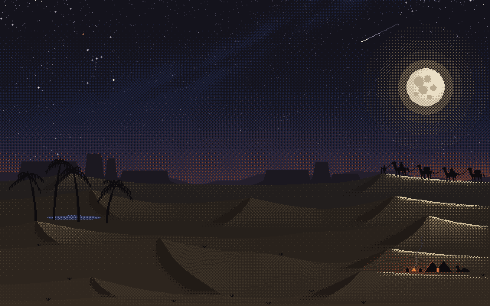

# claude-themes

Backdrop themes for the Claude Code desktop app. Each theme is a mod in its own folder, installed by name from this repository.

## Dunes Lite



A desert night printed in ordered dither, drawn behind the chat.

- **Still.** One picture, painted once: no animation and no frosted-glass blur, so it costs the app almost nothing. It was made because the animated backdrops felt laggy.
- **Night scene.** A ringed moon, the Milky Way, Orion, a shooting star, far mesas, six moonlit dunes, a camel caravan on the horizon, an oasis and a camp fire.
- **Matching colors.** The night scene also sets a dark palette for the app: warm near-black surfaces, sand-colored text and a moonlit blue accent.
- **Readable.** The middle of the window, where the conversation sits, uses only dark inks. The bright detail keeps to the edges.

### Install

At the prompt of a Claude Code terminal session:

```
/plugin install dunes-lite --marketplace anaCS-26/claude-themes
```

Answer `y` to add the marketplace, then pick a scope. Or from a shell:

```
claude plugin install dunes-lite --marketplace anaCS-26/claude-themes
```

Restart the desktop app, or start a new session, to see it. Backdrops draw in the desktop and mobile apps only, not in the terminal.

### Use

| Command | What it shows |
| --- | --- |
| `/dunes-lite night` | The desert night with its colors (the default) |
| `/dunes-lite classic` | The first still scene: umber paper and an ember sun |
| `/dunes-lite day` | The same on sand paper, for light mode |
| `/dunes-lite off` | No backdrop |

The choice is remembered across sessions. The night scene is made for dark mode.

### Change it

The night scene is `dunes-lite/hooks/nocturne.ts`, plain string building with no dependencies. `FINE` at the top sets the grain: 2 is the default, 1 is twice as coarse. The palette is in `dunes-lite/hooks/register.tsx`.

### Credits

Dunes Lite is adapted from the Dither Dunes scene in Anthropic's `theme-examples` plugin and keeps its Apache-2.0 license (`dunes-lite/LICENSE`). `make-colors.js` is the color helper that ships with Claude Code's plugin tooling.
